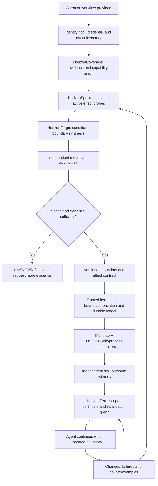

# MCPHorizon: Counterexample-Guided Security Boundary Synthesis and Evidence-Backed Agent Assurance

**Document type:** Research thesis + systems architecture + product feasibility assessment + implementation and validation roadmap  
**Prepared:** 2026-11-07  
**Repository:** https://github.com/crakashp2905-hub/MCPHorizon  
**Last verified `main` HEAD:** `a31ae652751ea5c3c3abceb281f18d7943d7f704` (authored 2026-11-05 UTC)  
**Status:** PROPOSAL / NOT AN ESTABLISHED NOVEL RESULT / NOT A SECURITY CERTIFICATION  
**Design principle:** Finish and independently validate existing modules for a precisely scoped deployment before assembling a general-purpose agent-onboarding platform.

> **Core thesis.** Given an AI agent and a partially observed effect environment, construct a bounded, evidence-supported model of all consequential actions *within a declared coverage scope*; actively probe unknown effect paths in a safe test setting; synthesize the least restrictive *actually enforceable* execution configuration; and either certify a precisely scoped invariant or issue an explicit `UNKNOWN` / non-certifiability explanation. Continuously invalidate claims when assumptions change.

**One-line product concept:** *Give MCPHorizon a supported AI agent; receive a reproducible threat map, a deployed effect-control boundary, and a machine-checkable report stating what is enforced, what remains unknown, and which assumptions make the report valid.*

## 1. Executive verdict

### 1.1 Potential and readiness are different questions

| Criterion | Judgment / rating | Interpretation |
|---|---:|---|
| Importance of customer problem | 9.3/10 | Autonomous agents have tool, identity, credential and external-effect risks. |
| Product concept attractiveness | **8.8/10** | Compelling *if* it works on a narrowly defined real-world scope. |
| Potential technical differentiation | 8.5/10 | Discovery + synthesis + evidence-backed abstention is promising; not shown unique. |
| Market timing | 9.0/10 | Growing budgets and rapidly emerging competitors. |
| Engineering viability for a supported Linux agent class | 7.5/10 | Feasible incrementally; not a universal drop-in for arbitrary agents. |
| Ease of adoption today | 4.0/10 | Credential, kernel, workflow and integration constraints remain. |
| MCPHorizon current unified-product readiness | **4.8/10** | Research code and candidate controls, not a deployed audited product. |
| Independent assurance today | 2.5/10 | No independently signed module-completion gates seen. |
| Scientific novelty *demonstrated* | 5.5/10 | New thesis with serious closely related prior art and unrun direct comparisons. |
| Concept potential once proven | 9.2/10 | Conditional opportunity, not a forecast or guarantee. |

These numbers are qualitative assessments, not measured accuracy, market share, revenue forecasts, or probability of publication.

### 1.2 Market reality

Gartner (August 26, 2026) projects the **overall securing-AI market** at approximately **$2.835B in 2026** and **$4.783B in 2027**; the broader category includes application security, gateways, usage control, governance and other segments. It is **not** MCPHorizon's serviceable available market and cannot be treated as startup TAM without segment-specific customer evidence. Source: https://www.gartner.com/en/newsroom/press-releases/2026-08-26-gartner-forecasts-the-market-for-securing-ai-will-reach-almost-5-billion-in-2027

Competition is already intense. NVIDIA OpenShell describes agent runtime isolation, gateway-brokered credentials, policy-enforced egress, and multi-agent boundaries. Check Point AI Agent Security offers discovery, risk posture and runtime guardrails. Noma announced agent/MCP access control. Cisco also describes agent discovery, identity and fine-grained access through MCP. **None of these facts entitles MCPHorizon to assert it is first to secure agents, provide runtime enforcement, or automate agent discovery.**

### 1.3 Recommendation

**Build a new research contribution *on top of* the existing hardening backlog, but do not add it to the trusted kernel before strong evidence exists.** Keep a stable non-bypassable authorization and execution path; treat exploratory discovery and synthesis as untrusted advisers; make independent validation and scope-limited claims the actual product interface.

---

## 2. What is proposed—and what is not

### 2.1 The novel *candidate* mechanism

**Counterexample-Guided Boundary Discovery and Synthesis (CGBDS)** is a workflow, algorithm and proof discipline:

1. **Observe** declared agent identity, purpose, tool specifications, system permissions, historical effects, and reachable sinks.
2. **Hypothesize** multiple effect graphs consistent with current observations; never infer hidden behavior from a tool description alone.
3. **Intervene** using harmless canary and controlled probes inside isolated replicas to distinguish hypotheses.
4. **Identify** the effect paths that can be mediated and those that are not observable or not controlled.
5. **Synthesize** least-cost combinations of mandatory brokers, capability restrictions, run placement, witnesses, task-specific approvals and data transformations.
6. **Check** the proposed boundary independently against a finite model and real receiver-side evidence.
7. **Admit or abstain** with an explicit, scoped certificate or `UNKNOWN`; optional human approval does not transform unknown effects into known ones.
8. **Invalidate and repair** when tools, credentials, policy epochs, observation coverage or behavior changes.

### 2.2 Not promised

- No claim that every AI agent can be fully secured or that model outputs are always safe.
- No security guarantee for hidden external-service effects that are neither observable nor controllable.
- No promise that a finite black-box probe budget can reveal every hidden action, trigger or covert channel.
- No replacement for OS isolation, identity providers, endpoint protection, human controls or compliance teams.
- No production use of speculative weight edits or learned System 1 predictions as authorization authority.
- No word such as "first", "only", "provably secure in general" or "10/10" in scientific claims without evidence.

### 2.3 Threat model and trust assumptions

**Actors:** agent (untrusted), tool server (untrusted unless explicitly contained), runtime adapter (untrusted or semi-trusted), trusted policy authority, enforcement sinks, independent effect witnesses, principal/approver, reviewer, and adversarial tool-output supplier.

**Threats in scope for the first prototype:** prompt injection that attempts unauthorized tool actions, malicious tool descriptions, unauthorized file writes, network exfiltration through direct/indirect paths, replayed approvals, tool-ID confusion, symlink/path substitution, delegation privilege escalation, restart/reconciliation races, false or omitted application logs, stale enforcement claims.

**Explicitly out of scope until separately supported:** compromised Linux kernel/hypervisor, unobservable dishonest remote side effects, hardware side channels, arbitrary kernel exploits, all covert channels, unknown external credentials, all browser extensions, arbitrary proprietary closed-agent internals, and production safety guarantees for weight-edited models.

The trusted computing base must be documented per supported deployment. An agent sharing the same credentials/UID/network authority as the protected sink may bypass mediation; the product must not issue a strong assurance claim in that configuration.

---

## 3. Scientific problem formulation

Let a hidden world \(w\in\mathcal W\) represent an agent's true executable capabilities, downstream service behavior, and actual effect graph. Let observations \(D\) constrain but not uniquely identify it. Define \(\mathcal W(D)\) as the worlds still consistent with the evidence, within an explicit hypothesis class \(\mathcal H\). Let \(\pi\in\Pi\) be a *deployable* configuration: specific runtimes, brokers, identities, capability grants, witnesses and policies.

Define unauthorized reachable effects \(U(w,\pi,\tau)\) for task \(\tau\) and a utility score \(Q(w,\pi,\tau)\). A candidate synthesis objective is:

\[
\pi^* = \arg\min_{\pi\in\Pi}\left[C_{\mathrm{run}}(\pi)+\lambda C_{\mathrm{latency}}(\pi)+\mu C_{\mathrm{utility}}(\pi)\right]
\]

subject to

\[
\forall w\in\mathcal W(D),\quad U(w,\pi,\tau)=\varnothing,
\qquad Q(w,\pi,\tau)\ge Q_{\mathrm{min}}(\tau).
\]

Additional constraints: (i) *real* sink mediation, (ii) permit bound to exact effect and commit-time policy epoch, (iii) non-escalating delegated authority, (iv) durable recovery/replay discipline, (v) an independent evidence witness for every outcome the certificate claims to verify.

**Three distinct outputs, never conflated:**

- `CERTIFIED_WITH_SCOPE`: a checker validates a proposal under stated model and deployment assumptions, and the required real-world witnesses exist.
- `CERTIFIABLE_AFTER_RELOCATION`: an available relocation or additional control closes an otherwise unmediatable path.
- `NOT_CERTIFIABLE_WITHIN_MODEL` / `UNKNOWN`: either every enumerated candidate is invalid in the *finite considered portfolio*, or observations/permissions are insufficient. The former is **not** a proof that no real-world solution could ever exist.

### 3.1 Active discovery objective

For an authorized diagnostic probe \(q\) with safe execution cost \(c(q)\), choose the probe expected to reduce security-relevant uncertainty:

\[
q^* = \arg\max_{q\in\mathcal Q_{\mathrm{safe}}}
\frac{\mathbb E[H(\mathcal W(D)) - H(\mathcal W(D\cup \mathrm{Obs}(q)))]}{c(q)}.
\]

This is an *algorithmic design target*, not an established optimality result. When two worlds are observationally equivalent on all allowed probes but have different unauthorized external effects, do **not** claim the hidden effect is discovered or protected. The correct outcome is `UNKNOWN` unless additional independent control/observation changes the information structure.

### 3.2 Proposed formal claims to attempt—not assumed proven

- **Claim C1 (soundness):** For a specified set of supported effects, a certificate implies mandatory mediation of every covered effect, assuming isolation and signer trust hold.
- **Claim C2 (finite synthesis completeness):** In a finite model and finite configuration portfolio, the synthesizer and independent checker enumerate all admissible options or provide exhaustive counterexamples.
- **Claim C3 (minimality):** The chosen boundary has minimum declared cost among feasible configurations in the considered portfolio.
- **Claim C4 (revocation):** A change to any certificate's dependency prevents a dependent protected effect until revalidation completes.
- **Claim C5 (epistemic honesty):** If observationally equivalent worlds disagree on authorization-relevant outcomes and no controlling boundary exists, the system does not issue a positive certification.
- **Claim C6 (security-utility improvement):** Against relevant matched baselines on independently authored worlds, the joint system reduces unauthorized effects without an equivalent collapse in legitimate completion.

All proofs must specify the relation between abstract steps and runtime code. Cross-host behavior requires different proof and experimental scope from a single SQLite node.

---

## 4. Proposed architecture



### 4.1 Responsibility separation

| Component | Inputs | Output | Authority |
|---|---|---|---|
| Agent inventory / Coverage | Configs, agents, permissions, captures | Typed effect and witness inventory | **No execution authority** |
| HorizonSpectra | Safe probes, hypothesis graphs, external journals | Discovered paths, uncertainty, reproducible counterexamples | Cannot execute uncontrolled production probes |
| HorizonForge | Required task utility, effect model, available controls | Candidate minimal configurations / bounded negative results | Advisory only |
| Independent checker | Candidate plan, frozen model, policy | Formal verdict and failure trace | No effect authority |
| HorizonZero | Evidence dependencies and trust roots | Scoped claims, expiry, revocation | May deny dependents; cannot grant authority alone |
| Trusted effect kernel | Exact effect, tenant, principal, policy, permit | Allow/block/unknown at commit | **Authoritative** for supported effects |
| File/HTTP/process sinks | Authorized effect and single-use permit | Actual operation + protected receipt | Only approved concrete effects |
| Independent oracle | Receiver/server/OS measurements | Observed effect evidence | Must be outside agent's writing authority |
| HorizonReflex | Encoded state/trace | Probabilistic effect/probe ranking | **Never** grants a protected effect |
| HorizonPatch / Sentinel / Transfer | Model checkpoints and eval sets | Experimental patches and risk reports | Research isolation, no automatic model promotion |

### 4.2 Example onboarding interaction

Input: a supported Linux-hosted agent with three MCP tools, one third-party API, a workspace and a secret-bearing customer database. Operator supplies intended task/purpose, identity, approved targets, exclusions and risk tolerance.

1. Inspector sees the agent can read from a private database and call `report.generate`.
2. A sandboxed HorizonSpectra probe with synthetic canaries reveals that `report.generate` contacts a second outbound destination not declared in its manifest.
3. HorizonForge chooses among: force an egress broker with only approved targets, relocate report generation into a protected local service, redact source data before remote use, or deny the remote operation.
4. Independent checker validates what effect paths are under the chosen mandatory boundaries; remote service's invisible internal actions are still marked `UNKNOWN` where applicable.
5. The operator approves the exact permitted task and policy; the agent receives attenuated, short-lived grants.
6. Execution moves through the protected ledger and actual brokers; a receiver-owned journal records effect outcomes.
7. HorizonZero creates a bounded assurance record linked to model, protocol, sink, policy and witness hashes; changes invalidate affected claims.
8. If the remote service cannot be observed or constrained and requires protected data, admission refuses or requires a safer workflow. **A signed self-report from that service does not prove absence of hidden effects.**

---

## 5. Mapping to current MCPHorizon code

**Evidence basis:** repository inspected at `a31ae652751e`, with latest recorded tests/verify green. The current 47-group / 282-task module checklist lives at `docs/hardening/MODULE_COMPLETION_GATES.md`. `docs/evidence/hardening/ASSUMPTIONS_AND_LIMITS.md` explicitly records **0/282 closed**, even though numerous candidate implementations exist. Treat completion as *evidence-gated*, not code-count-based.

| Role | Current locations / existing work | Hard prerequisite before integration |
|---|---|---|
| Canonical action and policy | `horizon/core`, `horizon/authz`, `horizon/effects/canonical.py` | Strict issuer/verifier parity, revocation epochs, cross-runtime semantics |
| Durable commit protocol | `horizon/effects/ledger.py`, `research/commitproof` | Multi-process crash testing, actual adapter wiring, external effect ambiguity |
| File sink | `horizon/effects/filesink.py`, sink process tests | Mandatory OS separation; independent observer; bypass red-team |
| Network effects | `horizon/runtime/broker.py`, `horizon/reach` | Real TLS and DNS behavior, controlled raw-socket bypass, dishonest external services |
| Protocol gateways | `horizon/adapters/mcp`, `horizon/adapters/utcp`, `horizon/codemode`, `horizon/a2a` | Official live interoperability, consistency across target/arguments and retries |
| Coverage | `horizon/coverage` | Independent effect inventory and bounded coverage certificates |
| Discovery | `research/spectra/tomography.py` | Real black-box services and independent fixture author; currently a finite toy |
| Boundary synthesis | `horizon/forge` | Larger configuration portfolio, typed effects, SMT/checker validation, real deployment |
| Claim registry | `horizon/assurance/registry.py` | Durable invalidation and revoked authorization propagation |
| Composition and indirect risks | `horizon/emergence`, `horizon/reach`, `horizon/mutation` | Adversarial held-out topologies and tested first-call disclosure limitations |
| Privacy/consent/budgets | `horizon/privacy`, `horizon/consent`, `horizon/budget` | Correct state sharing under restarts; utility metrics; independent evidence |
| Research replay | `bench/real`, `bench/dataset` | Distinguish real live intervention from offline counterfactual scoring |
| Weight-space | `research/weightspace` | Real *security* repairs, not only logit edits; keep model patches out of TCB |
| Autonomous development gates | `security_hardening`, `orchestrator`, `docs/verification` | Independently owned reviewer keys and immutable acceptance criteria |

**Existing strongest experimental advances:** (i) commit-protocol bounded state exploration found and fixed a recovery race and an orphaned authorization state; (ii) one Qwen2.5-0.5B live-agent lab recorded 18/18 attempted attacks succeeding ungated and 0/18 succeeding gated, but attacked-task utility was 0/24; (iii) a 64-entry Qwen2.5-0.5B weight-edit test altered a target logit and rolled back exactly—**not** a safety-repair result.

**Known serious negative results to retain:** HorizonReach's dishonest external service first-call disclosure (3 of 45 attack runs in its original suite); SecBench full system tying the simple read-then-send baseline; weak attacked-task utility in the new live experiment; no independently signed 47-module closure; offline replay cannot measure downstream agent adaptation.

---

## 6. Novelty and prior-art challenge

### 6.1 Closest research and products

| Work | Overlap with proposed thesis | What MCPHorizon must show beyond it |
|---|---|---|
| CaMeL (2025) and tracked-capability safety harnesses (2026) | Control/data separation, capabilities, effect discipline | Actual **unknown-path discovery** and verified boundary changes, not merely mediation |
| Agent-oriented access control / MCP gateways | Identity and authorization at tool boundary | An algorithm that discovers missing mediation, synthesizes boundary placements and quantifies unsupported coverage |
| NVIDIA OpenShell / Open Agent Safety Platform (2026) | Mandatory runtime containment, credentials, egress, independent infrastructure telemetry | Better automatically constructed coverage under hidden effects at matched resources, not "we have a sandbox" |
| Check Point AI Agent Security / Noma / Cisco | Agent discovery, posture, runtime policy, access governance | Evidence-backed adaptive boundary *synthesis* and correctly scoped non-certification |
| Formal synthesis, active system identification and runtime verification | Much of the mathematics and algorithm family | A nontrivial new agent-specific algorithm, proof or measured advantage across mixed effect semantics |
| Partial-observability feasibility theory (2026) | Indistinguishable latent worlds and when assurance is impossible | Concrete enforceable runtime synthesis, actual test probes, and effect-level verification—not a new impossibility principle alone |
| MATE (USENIX Security 2026) | Policy-conditioned agent auditing and synthesized trajectories | Real control-plane interventions and discovered downstream effects rather than trajectory-level classification |

**Novelty must be framed as a *conjunction of demonstrated capabilities*, not just a rebranding of old theory.** A sound simpler solution is a falsifier, not an inconvenience to be hidden.

### 6.2 Explicit falsifiers

- A fixed policy plus NVIDIA OpenShell-style runtime performs equally well with the same permissions, observers and costs.
- An existing capability system plus straightforward test discovery reaches equivalent coverage and benign utility.
- Synthesis does not choose substantively different configurations from static templates in held-out cases.
- An active probe method only discovers effect channels already visible in static manifests.
- The claimed certificate depends on untrusted agent/tool logs or an unobservable remote service assertion.
- `UNKNOWN` is silently treated as clean, or a previously invalidated claim can still authorize effects.
- A learned probe ranker matches or underperforms cheap heuristics at the same diagnostic budget.

### 6.3 Priority claim discipline

Do not say "no closely related work exists." Conduct dated bibliographic searches using IEEE/ACM, arXiv, USENIX, security vendors, patents, formal-synthesis and system-identification keywords; record source URLs, exact research claims, key algorithmic differences, and whether independent experiments support them. Obtain an independent reviewer to sign the novelty matrix. With new relevant work appearing, re-run the audit before submission or public launch.

---

## 7. Decisive evaluation program

### 7.1 Research questions

- **RQ1:** Can independent active probes uncover security-relevant effect paths omitted by tool manifests and application logs?
- **RQ2:** Does synthesizing boundary placement and controls preserve more legitimate utility than static universal restrictions at equal unauthorized-effect risk?
- **RQ3:** Does the combined system abstain correctly when remote behavior is observationally unidentifiable?
- **RQ4:** Do formally certified properties survive runtime implementation, crash, restart, deployment and protocol composition?
- **RQ5:** Does continuous invalidation stop new protected effects after meaningful policy/adapter/identity changes?
- **RQ6:** Is the combined approach cost-effective relative to a carefully configured modern runtime platform?

### 7.2 World families

Develop *independently authored* worlds including: hidden file writes, child-process effects, latent additional network calls, DNS rebinding, redirects, public buckets, delegated agents, tool-server version swaps, stolen/stale tokens, argument canonicalization errors, log forgery, witness outage, mixed MCP/UTCP action equivalence, code-mode filesystem bypass, sequential read-and-send effects, restart races, remote service dishonest attestation, multi-agent transitive delegation, contaminated memory, rate/consent obligations and benign lookalikes.

Include at least one family where a safe relocation exists, one where simple fixed rules suffice, and one where certification is impossible without new control. Do **not** invent ground truth from the synthesizer's output.

### 7.3 Baselines (same information and privilege budget)

- B0: no defense.
- B1: coarse read-then-send rule (important because it has matched MCPHorizon previously).
- B2: tool allowlist + static manifests.
- B3: standard least-privilege gateway / policy engine.
- B4: fixed sandbox/egress broker configuration using relevant NVIDIA OpenShell capabilities when reproducibly available.
- B5: capability-based agent runtime or faithful CaMeL/tracked-capability implementation where compatible.
- B6: static graph discovery without active probes.
- B7: active probes without synthesis.
- B8: synthesis without active probes.
- B9: synthesis without a trusted witness.
- B10: full system with and without evidence-claim invalidation.

Unimplemented or incompatible published systems must be marked *not compared*, not given invented benchmark scores. Record failed integration and limitations separately.

### 7.4 Metrics and minimum reporting requirements

| Metric | Measurement | Reporting requirement |
|---|---|---|
| Unauthorized effect rate | Independent receiver/OS-owned sink journal | Numerator, denominator, attack family and confidence interval |
| Legitimate task completion | Real agent task oracle, not model self-assessment | Clean and attacked-task utility separately |
| Effect-boundary discovery | True newly discovered covered edges vs ground truth | Precision, recall, unknown coverage, probe budget |
| False certification | Positive certificates in unsafe or unobservable worlds | Must disclose every counterexample |
| Correct abstention | UNKNOWN in observationally indistinguishable unsafe/safe pairs | Separate from attack prevention |
| Synthesis utility loss | Task success and required operator approvals | Pareto frontier vs static baselines |
| Cost optimality | Enumerated portfolio / SMT objective | Optimality gap; proof/exhaustiveness scope |
| Invalidation latency | Change event to all dependent permit refusals | p50/p95/p99 and worst observed cases |
| Execution performance | Broker and policy overhead on pinned hardware | p50/p95/p99, throughput, tail timeouts |
| Operational cost | CPU, RAM, witness storage, probe counts, failures | Hardware and reproducible fixture costs |
| Cross-protocol parity | Same effect via varied adapters | Decision and downstream-effect equivalence |
| Recoverability | Kill/failover around authorization and sink commit | Exactly what is known vs `UNKNOWN` |

**Statistical design:** preregister the primary metric and effect size; power by independent *attack families* rather than counting near-identical prompts as independent; preserve paired seeds; use cluster-aware intervals and multiplicity control; freeze held-out fixtures before code comparison; record actual denied benign outcomes and nonresponses. Zero observed leaks is not proof of zero risk.

### 7.5 Three landmark experiments

**EXP-A: Hidden channel with equal visible logs.** Two remote tool services return the same apparent logs; one has an undeclared downstream effect. If no controlled sink or witness covers that consequence, HorizonSpectra must refuse certification. After relocating service execution into a contained test environment, probes can discover the extra effect and synthesis can enforce an appropriate constraint.

**EXP-B: Boundary synthesis vs fixed configurations.** One workflow legitimately needs a public aggregate from sensitive input. A blanket read-then-send block kills utility. A cheap fixed allowlist leaks via an indirect path. HorizonForge may choose local aggregation plus brokered publication, allowing the task while preventing the hidden transfer. The result must be compared against the strongest *configured* existing systems, not strawmen.

**EXP-C: Live invalidation and recovery.** A previously covered agent updates a tool, revokes an approval and loses a witness during a crash/recovery window. HorizonZero dependencies and the durable ledger must refuse new protected effects until re-certified, with sink-owned evidence distinguishing committed, blocked and uncertain outcomes. Test concurrent and adversarial recovery, including the previously discovered late-write race.

### 7.6 Paper-specific exit gates

1. A *single* falsifiable, tightly scoped central claim.
2. Independently verified prior-art matrix.
3. At least one new algorithmic or formal result not trivially assembled from existing baselines.
4. Published model/checker correspondence and proven scope, with negative results.
5. Independent attack fixtures and outcome witnesses.
6. Strong baselines run on compatible threat and utility assumptions.
7. Reproducible experiment freeze, tests, raw observations, exact commits and pinned versions.
8. External reproduction of the central result.
9. Clear utility, latency, false certification and uncertainty costs.
10. No claims of unrestricted generality.

Potential security-paper venues (conditional): USENIX Security, ACM CCS, NDSS or IEEE S&P. A formal-methods-oriented version may fit a formal verification or programming-languages venue. Venue fit depends on the **actual result**, not the size of the repository.

---

## 8. Product vision and customer workflow

### 8.1 What is the product?

**A security-boundary compiler and continuous assurance plane for supported agent workflows.** The first paid-value proposition is reducing manual agent security architecture work and making controlled agent execution reviewable—not "perfectly securing any agent in one click."

### 8.2 Proposed user journey

1. **Connect:** register agent repository/runtime, deployment environment, owner, intended task and supported integrations.
2. **Inventory:** discover tools, data, identities, credentials, execution and side-effect capabilities.
3. **Threat map:** present direct and indirect effects and highlight unobserved channels.
4. **Test:** run safe attack/benign probes in an isolated clone with synthetic data.
5. **Construct:** propose a constrained runtime and protected effect-path configuration.
6. **Review:** compare security-versus-utility options, refusal paths and evidence obligations.
7. **Enforce:** deploy only supported, reviewed brokers/sandboxes/permissions; no untrusted model changes.
8. **Observe:** publish sink-owned effect receipts, replay/recovery outcomes and exact coverage.
9. **Attest:** deliver versioned assurance report, expiration and residual-risk list.
10. **Revalidate:** invalidate or re-synthesize when the agent, tool server, credentials or policy changes.

### 8.3 Initial product surface

**CLI + declarative contracts first.** Design a small set of stable commands, without advertising them as implemented today:

```bash
horizon inspect ./example-agent --contract agent-policy.yaml
horizon probe --profile isolated --canary synthetic --max-effects 0
horizon synthesize --objective least-restrictive --scope effects-v1
horizon verify --plan plan.json --witnesses receiver-owned
horizon deploy --approved-plan plan.json
horizon status --show-covered --show-unknown --show-revoked
horizon evidence export --scope run-123 --format json
```

Here `--max-effects 0` means no uncontrolled external effect; permitted diagnostic effects are confined to fixture-owned isolated sinks. These are **proposed** APIs; exact semantics must be specified in the protocol contracts.

### 8.4 Product claims that can be safely marketed when independently supported

- "Enforces your approved effect policy at the supported broker/sandbox boundaries."
- "Discovers and documents selected undeclared effect paths under controlled tests."
- "Shows precisely which paths are covered, unknown or unsupported."
- "Produces replayable evidence and invalidates stale assurance when dependencies change."
- "Preserves task utility more effectively than listed baselines *on the documented evaluation*."

**Avoid:** "secures every agent," "unbreakable," "guarantees no data leakage," "autonomously fixes all AI safety issues," "provably safe" with no finite scope.

---

## 9. Competitive strategy

### 9.1 Competitive reality (as of November 2026)

| Company/product | Publicly described capabilities | MCPHorizon opportunity if validated |
|---|---|---|
| NVIDIA OpenShell / Agent Safety Platform | Controlled runtime, isolation, brokered credentials, policy egress, out-of-band monitoring | Open, independent boundary discovery and *minimum viable configuration synthesis* across supported runtimes; could integrate rather than replace |
| Check Point AI Agent Security (Lakera) | Cross-platform discovery/posture; guardrails across prompt/tool/model traffic | Effect-level consequences and scope-aware evidence rather than only content/risk indicators |
| Noma Security | Discovery and access governance for agents/MCP | Formal/measured boundary construction, not just tool access policy |
| Cisco agentic security | Identity, tool scope, JIT access, MCP controls | Independent effect witnesses, refusal under unobservable remotes, adaptive control placement |
| Datadog AI Guard | Inline monitoring and blocking over prompts, tools, MCP and API calls | Synthesized enforcement and formal assurance claims rather than behavioral-baseline-only evaluation |
| Existing capability & policy systems | Fine-grained permitted effects | Detecting missing implementation paths and selecting actual enforcement placement |

**Important:** This table reflects publicly documented features and potential positioning, not a direct head-to-head technical test. Some vendors may have undocumented or newly released analogous functionality. Independent comparative trials are necessary before making superiority claims.

### 9.2 Recommended wedge (do not overcommit to a vertical)

Start by proving one *integration class*, not choosing one regulated sector: **self-hosted Linux agents with MCP tools, a protected workspace and limited HTTP egress**. This allows complete control over the OS/user/network trust boundary and makes sink effects independently measurable.

Subsequent supported classes can include browser agents, multi-agent delegation, enterprise SaaS connectors and other execution environments. Unsupported modalities remain explicitly unsupported.

This engineering wedge preserves broad long-term applicability while avoiding a claim to instantly secure proprietary, remote, unmanaged agents.

### 9.3 Buyers, adopters and partners to validate

- Security engineering / application security: evidence of bypass prevention and policy correctness.
- AI platform engineering: simpler secure deployment without rewriting orchestration code.
- Infrastructure / cloud teams: runtime isolation, network controls and auditable failures.
- Compliance / internal audit: precise artifacts and immutable security scope (not automated regulatory compliance).
- Agent framework vendors: embeddable enforcement and portable integration contracts.

Do **not** assume these constituencies will pay, or that one product UX fits them all. Validate actual workflows and willingness-to-pay in controlled pilots.

### 9.4 Product shape hypotheses

- **Open-source security kernel and conformance harness** to build developer trust; evidence formats and verification portable.
- **Self-hosted enterprise assurance plane** for fleet policy, reviewer workflows, identity, signed evidence, support and operations.
- **Partner/embedded runtime integrations** for existing agent platforms, using their sandboxes where appropriate.
- **Evaluation service** can be a research/demo surface but must not be presented as certified penetration testing without human expertise.

No pricing or revenue claims are validated. Test value through integration effort, review time, false-block reduction, coverage gains and repeat usage, then design pricing based on observed costs and procurement constraints.

---

## 10. Economics and operational viability

### 10.1 Possible value drivers

- Reduced security-architecture effort for each new agent/tool integration.
- Fewer accidental unsafe effects through mandatory mediation.
- Higher benign-task completion than blanket-deny controls.
- Faster review of upgrades via signed/reproducible evidence.
- Faster incident response due to independent effect records and precise revocation.
- Less vendor lock-in by separating security contracts from specific model or agent frameworks.

### 10.2 Likely cost drivers

- Probe runs in replicated environments, especially with real models.
- OS-level isolation and trusted effect broker hosting.
- Persistent audit/witness storage and retention.
- Compatibility with fast-moving tools, SDKs, kernels and cloud providers.
- Key management, independent security assessment and on-call reliability.
- Human review for irreversible or unobservable effects.
- Customer security procurement and integration effort.

A product may fail commercially even with sound science if setup overhead, blocked task utility or infrastructure costs outweigh the value. The key commercial metric is not "attacks blocked" alone, but **net secure task completion per unit cost and integration effort**.

### 10.3 Market sizing discipline

Use Gartner's ~$4.8B *2027 market for securing AI* as contextual validation only. Before constructing revenue projections, estimate a bottom-up serviceable segment from number of supported agents, number of customers that can run a controlled gateway, willingness-to-pay, enterprise deployment complexity, retention and gross margin. Do not multiply a generic AI spending statistic by an assumed market-share percentage.

---

## 11. Prioritized completion roadmap (module first, platform second)

The source of truth for the full module checklist remains `docs/hardening/MODULE_COMPLETION_GATES.md`: **47 module groups, 282 tasks; 0 closed in the latest inspected evidence registry**. This document does not replace or mark those items complete. The following checkpoints are added as integration-specific research/product gates.

### Stage S0 — Strict evidence ledger and release discipline

- [ ] S0-01 Freeze exact commit, tool versions, model, platform, threat scope and test data for each experiment.
- [ ] S0-02 Add cross-module assurance dependency graph (policy, signer, sink, adapter, oracle).
- [ ] S0-03 Build independently controlled reviewer signing and rotation workflow.
- [ ] S0-04 Ensure candidate implementations cannot mark themselves verified.
- [ ] S0-05 Preserve all historical negative results and post-hoc changes.
- [ ] S0-06 Add dashboard/report distinguishing IMPLEMENTED, INTEGRATED, ADVERSARIAL_TESTED, INDEPENDENTLY_VERIFIED and UNSUPPORTED.
- [ ] S0-GATE Reviewer verifies that no incomplete module has been promoted.

### Stage S1 — Mandatory effect security foundation (critical path)

- [ ] S1-01 Canonicalize every supported effect and bind exact arguments/targets to authorization.
- [ ] S1-02 Make permit issuance and commit verification use the same domain-separated representation.
- [ ] S1-03 Carry principal, tenant, tool server, session, delegated authority, epoch and expiry consistently.
- [ ] S1-04 Ensure at-most-once dispatch and explicit uncertainty under crash/recovery.
- [ ] S1-05 Test separate-process and cross-process writer races, including a fenced late writer.
- [ ] S1-06 Enforce real OS-level separation so agent cannot directly write protected sink.
- [ ] S1-07 Implement real HTTPS/redirect/DNS egress control; prevent socket bypass in the supported runtime.
- [ ] S1-08 Keep sink journals independently owned and tamper-evident.
- [ ] S1-09 Execute a real MCP agent request through the authorization/ledger/sink/receipt path.
- [ ] S1-10 Measure clean and attacked task utility, not just refused calls.
- [ ] S1-GATE Independent real-effect test and no known bypass within supported scope.

### Stage S2 — Coverage and active tomography

- [ ] S2-01 Define `EffectEdge`, `TrustZone`, `Witness`, `Probe`, `Observation`, `HypothesisWorld` typed schemas.
- [ ] S2-02 Define explicit instrumented vs uninstrumented effect classes.
- [ ] S2-03 Connect the existing Spectra finite hypothesis engine to isolated receiver-owned fixtures.
- [ ] S2-04 Add uncontrolled-probe effect ceilings and canned synthetic data only.
- [ ] S2-05 Add hidden file/HTTP/child-process/delegated-effect tests not derived from the same code as the detector.
- [ ] S2-06 Preserve UNKNOWN on hypothesis indistinguishability, exhausted probe budget or missing witness.
- [ ] S2-07 Compare active probe selection against random, static graph and expert-rule probes.
- [ ] S2-08 Add adaptive probes only if they cannot cause unauthorized production effects.
- [ ] S2-09 Freeze independent outcome traces and per-path ground truth.
- [ ] S2-GATE Demonstrate a new effect edge detected where static manifests miss it, with honest uncertainty.

### Stage S3 — Minimal enforceable boundary synthesis

- [ ] S3-01 Extend Forge IR beyond toy placements into real file/network/process/remote effect classes.
- [ ] S3-02 Represent available broker/sandbox/relocation/declassification mechanisms and constraints.
- [ ] S3-03 Make utility floor explicit per task; a blanket denial must not be called a successful solution.
- [ ] S3-04 Implement exhaustive finite solver first; compare against SMT/optimization solver when justified.
- [ ] S3-05 Separate untrusted candidate synthesizer from trusted checker and effect enforcer.
- [ ] S3-06 Verify minimal-cost and Pareto-optimal alternatives under declared model assumptions.
- [ ] S3-07 Generate machine-readable negative certificates for every portfolio-exhausted case.
- [ ] S3-08 Make plan deployment transactional, reviewable, and reversible; preview cannot touch production sinks.
- [ ] S3-09 Run counterexample-guided refinement to close gaps discovered by independent witnesses.
- [ ] S3-10 Retest policies after relocation, upgrade and adaptive attack.
- [ ] S3-GATE Independent validation of synthesized boundary and workload utility on a real agent.

### Stage S4 — Continuous assurance and revocation

- [ ] S4-01 Turn HorizonZero registry entries into signed, durable, scoped dependency claims.
- [ ] S4-02 Bind certificate to exact agent, runtime, policy, tool, witness, artifact, issuer and verifier versions.
- [ ] S4-03 Invalidate on adapter/tool/agent changes, revoked consent, lost journal, expired proof or changed policy.
- [ ] S4-04 Make dependent future effects refuse automatically until restored.
- [ ] S4-05 Crash-test claim revocation and approval races across independent processes.
- [ ] S4-06 Preserve old receipts and event histories without rewriting failed claims as success.
- [ ] S4-07 Distinguish SOURCE-VERIFIED from independently reproduced or externally audited.
- [ ] S4-08 Test two observationally equivalent worlds with conflicting safety outcomes.
- [ ] S4-GATE A reviewer can reproduce certificate issuance, revocation and UNKNOWN behavior without system author assistance.

### Stage S5 — Real-agent validation, hard baselines and novel contribution

- [ ] S5-01 Build new independently authored, split-heldout threat worlds.
- [ ] S5-02 Use live real-model agents rather than only offline trajectory replay.
- [ ] S5-03 Implement and run coarse read/send, static gateway, capability and OpenShell-style runtime baselines.
- [ ] S5-04 Retain scenarios where baselines outperform MCPHorizon.
- [ ] S5-05 Demonstrate nontrivial boundary changes instead of policy-template selection.
- [ ] S5-06 Establish formal claims plus code-level conformance, with proof of assumed equivalence where possible.
- [ ] S5-07 Run leave-one-family-out, unseen tools, deception and adaptive adversaries.
- [ ] S5-08 Quantify task success under attack, false blocks, UNKNOWN burden and probe overhead.
- [ ] S5-09 Independently validate source and ground-truth labels; analyze dataset contamination.
- [ ] S5-10 Reproduce headline result in clean environment with another operator.
- [ ] S5-GATE Paper candidate must beat a strong relevant baseline on a preregistered primary claim or explicitly narrow thesis.

### Stage S6 — Narrow product pilot, only after gates

- [ ] S6-01 Select one *supported integration class* and publish capability coverage matrix.
- [ ] S6-02 Provide CLI, versioned contract, evidence export and fail-closed error behavior.
- [ ] S6-03 Run private trials with synthetic data first, without blanket security guarantees.
- [ ] S6-04 Measure onboarding time, total infrastructure cost, task completion and operator interventions.
- [ ] S6-05 Conduct key, identity, supply-chain, incident and secrets review.
- [ ] S6-06 Add staged rollout, rollback, emergency kill switch and backup/restore.
- [ ] S6-07 Integrate customer feedback with module gate process; never let product marketing override evidence.
- [ ] S6-08 Test willingness-to-pay and adoption friction; build bottom-up segment economics.
- [ ] S6-GATE Only promote claims directly supported by independently validated protected paths.

### Stage S7 — Research extensions, intentionally *non-blocking* for initial product

- [ ] S7-01 HorizonReflex: learn fast System 1 rankings for safe diagnostic probe selection.
- [ ] S7-02 Compare against strong non-ML and active-learning baselines with fixed probe budgets.
- [ ] S7-03 HorizonPatch: test sparse weight repair of agent authority confusion with **real unauthorized-effect metrics**.
- [ ] S7-04 HorizonSentinel: gate any candidate model patch against utility, tamper and safety regression.
- [ ] S7-05 HorizonTransfer: assess translation of causal safety edits across architectures, publish null results.
- [ ] S7-06 Prevent experimental model changes from granting new privileges or becoming self-verifying.

---

## 12. Risk register and decision rules

| Risk | Severity | Evidence/trigger | Decision |
|---|---|---|---|
| Unmediated path bypasses gateway | Critical | Direct OS/network access by agent | Deny assurance; fix isolation before pilot |
| Dishonest remote side effects | Critical | Tool has access to secret and hidden off-host action | Relocate, withhold sensitive input, or return UNKNOWN |
| False certificate / shared trust roots | Critical | Agent writes witness logs or signs approval | No certification; separate trust domains |
| Reconciliation race / repeated effect | Critical | Late worker after ambiguous commit | Fence sink, durable ledger, adversarial restart tests |
| Blanket blocking destroys utility | High | Attacked-task success near zero | Make task floor and remediation alternatives first-class |
| Novelty swallowed by existing runtime platform | High | Strong baseline matches security-utility | Narrow research claim; improve algorithm, don't overmarket |
| Black-box test incompleteness | High | Unknown trigger outside probe budget | Bound claims; show observed vs unobserved paths |
| Dataset saturation/author bias | High | Simple rules perfect on synthetic templates | Independent authoring and held-out real systems |
| Deployed patches alter model safety | High | System 1/weight edits change safety behavior | Research-only, independent approval |
| Multiple runtimes weaken semantic parity | High | MCP/UTCP/Code Mode inconsistency | Conformance, canonical effect schema, explicit unsupported |
| Enterprise key management not ready | High | In-process symmetric secrets/no rotation | No commercial-grade assurance claims |
| Portability gap | Medium | Linux-only enforcement | State supported OS/kernel/runtime precisely |
| Patent and licensing conflicts | Medium | Third-party runtime/code/model licenses | Review before redistributing or commercializing |
| High operator cost and false positives | High | Probe cost/alerts outweigh safe task utility | Measure unit economics; narrow first-class deployment |

**Decision rule:** The user experience may be simple, but the security guarantee may never be simplified beyond what the independent evidence actually covers.

---

## 13. Sample contract and certificate (illustrative, not implemented schema)

```yaml
api_version: mcphorizon.example/v0
agent:
  id: report-agent
  owner: security-team
  runtime: linux-isolated
  model: pinned-open-model-or-external-id
purpose:
  allowed_task: generate_redacted_report
  minimum_utility: complete_summary_and_authorized_public_export
identity:
  service_principal: report-agent-prod
  delegated_user_required: true
boundaries:
  workspace:
    read: [/work/public, /work/private]
    write: [/work/output]
  network:
    approved_hosts: [reports.example.test]
    raw_sockets: deny
  remote_effects:
    unknown_hidden_sends: deny_protected_data
  execution:
    child_process: deny_unless_mediated
witnesses:
  file: protected_inode_and_journal
  network: receiver_owned_event_log
assurance:
  uncovered_effect_action: UNKNOWN
  invalidate_on: [tool_digest, policy_epoch, runtime_digest, witness_health]
```

A future certificate should bind an immutable digest of the approved contract, agent/runtime image, policy epoch, effect classes, observer authority, checker version, exact tested scenarios, known residuals, expiry, and independently verifiable signature. **A certificate describing a toy finite model does not automatically certify the real-world deployment.**

---

## 14. Product thesis tests: proceed, revise or stop

**Proceed to a scoped pilot** only if: one real-agent class has mandatory effect mediation; certificate dependencies are durable; a separate trust domain witnesses outcomes; the worst known bypasses are handled or explicitly out of scope; independent verifier signs release; benign and attacked task-utility meet *predeclared, use-case-specific* acceptance thresholds; and latency/cost is operationally tolerable.

**Revise the product wedge** if: integration friction is high, customers already use a sufficiently equivalent platform, buyer values monitoring more than automatic synthesis, or required third-party systems cannot be observed/controlled.

**Stop or narrow the research thesis** if: correctly configured existing runtime + static policies matches all core outcomes on independent scenarios; synthesize-and-probe does not materially outperform simple approaches; or claimed certificates depend on untrusted measurements.

The most defensible differentiated product promise is:

> **MCPHorizon compiles supported agent workflows into explicit, enforced effect boundaries and reports evidence of what those boundaries do—and do not—protect.**

That is a strong business hypothesis and an interesting scientific direction. It is not yet a demonstrated breakthrough or a general safety guarantee.

---

## 15. Source and prior-art register (verified public references)

**Market and product primary sources**

1. Gartner, *Market for Securing AI Will Reach $4.8B in 2027* (Aug 26, 2026): https://www.gartner.com/en/newsroom/press-releases/2026-08-26-gartner-forecasts-the-market-for-securing-ai-will-reach-almost-5-billion-in-2027
2. NVIDIA, *OpenShell runtime description*: https://www.nvidia.com/en-in/ai/openshell/
3. NVIDIA, *Open Agent Safety Platform*: https://www.nvidia.com/en-sg/solutions/ai/agent-safety/
4. Check Point AI Agent Security, product documentation: https://docs.lakera.ai/docs/agent-security
5. Noma, *Agentic Access Control* (Jun 2, 2026): https://noma.security/blog/noma-launches-agentic-access-control-to-govern-ai-agents-and-mcp-servers-across-the-enterprise
6. Cisco, *Zero Trust for Agentic AI Security*: https://www.cisco.com/site/us/en/solutions/artificial-intelligence/security/securing-agentic-ai/index.html
7. Datadog AI Guard: https://www.datadoghq.com/products/security/ai-guard/
8. Docker/Snyk/Keycard, *Agent Baseline draft*: https://www.docker.com/blog/a-new-security-baseline-for-enterprise-agentic-adoption/

**Research and foundational overlap**

9. Odersky et al., *Securing Agents With Tracked Capabilities* (CAIS 2026): https://doi.org/10.1145/3786335.3813127
10. *Towards Verifiably Safe Tool Use for LLM Agents* (ICSE 2026): https://doi.org/10.1145/3786582.3786839
11. *MATE: Policy-Aware Security Auditing for Mobile Agents* (USENIX Security 2026): https://www.usenix.org/conference/usenixsecurity26/presentation/jiang-changyue
12. *A Framework for Reliable Deployment and Monitoring of AI Decision Systems Under Partial Observability* (2026): https://www.mdpi.com/2076-3417/16/10/4917
13. *Beyond Guardrails: Runtime Enforcement for Secure AI Agents—A Systematic Review* (2026): https://www.icck.org/article/abs/jrsc.2026.526903
14. Google Research, *SoK: Security Vulnerabilities in Agentic AI Systems*: https://research.google/pubs/sok-security-vulnerabilities-in-agentic-ai-systems/
15. NVIDIA, *Where Security Fits in an AI Agent Stack*: https://developer.nvidia.com/blog/where-security-fits-in-an-ai-agent-stack/
16. Microsoft, *Least Privilege for AI Agents* (Jul 2026): https://www.microsoft.com/en-us/security/blog/2026/07/16/least-privilege-for-ai-agents-identity-access-and-tool-binding/

**MCPHorizon repository evidence references**

17. Module completion: `docs/hardening/MODULE_COMPLETION_GATES.md` and `docs/evidence/hardening/ASSUMPTIONS_AND_LIMITS.md`.
18. Commit-protocol bounded proof: `docs/evidence/commitproof/ASSUMPTIONS_AND_LIMITS.md`.
19. Live-model result: `research/live/results/live_qwen05.json`.
20. Sparse weight-space experiment: `research/weightspace/results/real_qwen05.json`.
21. Main paper negative baseline result: `paper/MANUSCRIPT.md`.
22. Original P54 frozen integration findings: `docs/evidence/p54/RESULTS.md`.
23. Research track maturity: `docs/research/RESEARCH_PROGRAM_STATUS.md`.

**Source caveat:** commercial product descriptions are vendor claims unless independently tested; external work evolves rapidly. The bibliographic list is a starting register, not a comprehensive systematic review or proof of priority.

---

**Final decision:** Research concept **promising but not yet proven novel**. Product concept **8.8/10 potential**. Current unified production maturity **4.8/10**. Prioritize mandatory effect enforcement and independently evidenced module completion, then run the discovery–synthesis–assurance thesis against strong modern baselines on real, held-out agent systems.
