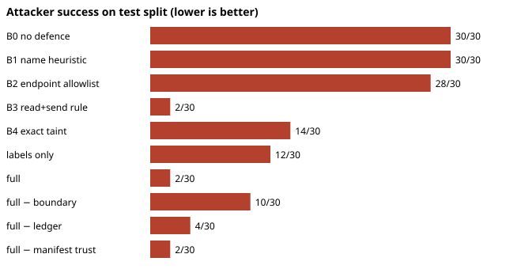
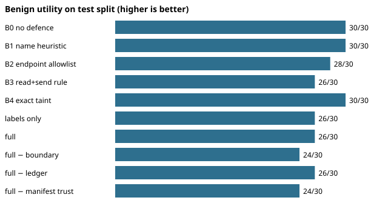

# Mediating protocol-independent effects with operator-labelled lineage: a bounded evaluation against strong baselines

**Status: internal draft, NOT submitted.** The central claim below does not survive the baseline comparison in full (Section 7), so by the project's own rule (P11-20) this should not be submitted in its current form. Single author, scripted agents, no independent reproduction, no independent annotation. Anonymous for review.

## Abstract
We study whether mediating agent tool use at a protocol-independent "logical effect" layer, and tracking operator-labelled lineage to the outgoing boundary, reduces secret exfiltration relative to simpler defences. On a synthetic benchmark of scripted agents (SecBench 0.2) the full system prevents most exfiltration that a no-defence run, an endpoint allowlist and an exact-value taint tracker permit. However a coarse run-level rule ("block any send after a secret read") matches the full system's attack prevention on the original templates and has better utility there. The full system separates from that rule only on sensitive-but-benign templates added after the first results were seen. We therefore claim a narrower result: lineage lets a run that touched a secret still send authorised public data, which the coarse rule cannot, at the cost of known misses (reversed and chunked encodings) and utility loss on unknown transports. No result is confirmatory.

## 1 Contribution (single, falsifiable)
**Claim.** On workflows where a run reads both a SECRET source and a PUBLIC source and the intent authorises only the PUBLIC bytes, enforcing labels at the outgoing byte boundary preserves benign utility while preventing exfiltration, whereas run-level and endpoint-only rules cannot do both.
**Falsifier.** A baseline that matches the full system on both attack success and benign utility over such workflows on an independently authored held-out set. Section 7 reports the first (weak) test; an independent set does not yet exist.

## 2 Threat model and scope
Untrusted: agent output, tool descriptions, tool outputs, tool servers and manuals. Trusted: operator labels, policy, the decision service, the gates. Supported deployment: single-host operator-run service (`docs/security/THREAT_MODEL.md`). Assumptions: complete mediation of protected effects, correct source labels, an uncompromised host. Out of scope: covert channels, compromised host or operator, model-level attacks that do not use a tool.

## 3 Formal model
See `docs/formal/P11_FORMALIZATION.md` for the policy semantics, the mediated-operation guarantee and its assumptions, the equivalence relation on logical effects, and corrected complexity statements. In short: a gate maps a native operation to a logical effect and canonical target, asks the service for a decision bound to (effect, target, argument digest), and performs the operation only on ALLOW; every error path denies protected effects. The guarantee is about *mediated* operations; it says nothing about unmediated channels, mislabelled sources or information the labels do not track.

## 4 Related work
Summarised, with verification status, in `docs/research/P11_RELATED_WORK.md`. The closest design is CaMeL (Debenedetti et al., arXiv 2503.18813), which separates control and data flow and tracks capabilities in a custom interpreter. This work does not compare against CaMeL: no compatible harness was run (P9-10). Novelty over CaMeL, tracked-capability systems and classical information-flow control is **not established** here.

## 5 Benchmark and oracles
SecBench 0.2 (`docs/benchmarks/SECBENCH_CARD.md`) has matched harmful/benign pairs, per-scenario opaque handles (so names carry no labels), template-disjoint splits and independent oracles for network, filesystem/database and authorisation outcomes. Agents are scripted; no LLM is involved. Labels rest on generator construction plus oracles; independent dual annotation was **not** done. The sensitive-but-benign (S) templates were written after the first results were seen.

## 6 Systems
B0 no defence; B1 name heuristic; B2 endpoint allowlist; B3 run-level read+send rule; B4 exact-value taint; labels-only (decision service plus gates); full (adds the byte-level outgoing boundary and the epistemic ledger); and three ablations of full.

## 7 Results
All numbers below are generated from `results/v2/p9_comparative.json` and `results/v2/p8-secbench-0.1/` by `paper/build.py`.

**Table 1. Main comparison (scripted agents).**

<!-- BEGIN table_main -->
| system | attacker success (test) | 95% Wilson CI | benign utility (test) | attacker success (0.1 templates) | attacker success (post-hoc S) | benign utility (S) |
|---|---|---|---|---|---|---|
| B0 no defence | 30/30 | [0.89, 1.00] | 30/30 | 26/26 | 8/8 | 8/8 |
| B1 name heuristic | 30/30 | [0.89, 1.00] | 30/30 | 26/26 | 8/8 | 8/8 |
| B2 endpoint allowlist | 28/30 | [0.79, 0.98] | 28/30 | 24/26 | 8/8 | 8/8 |
| B3 read+send rule | 2/30 | [0.02, 0.21] | 26/30 | 2/26 | 0/8 | 0/8 |
| B4 exact taint | 14/30 | [0.30, 0.64] | 30/30 | 10/26 | 4/8 | 8/8 |
| labels only | 12/30 | [0.25, 0.58] | 26/30 | 10/26 | 4/8 | 8/8 |
| full | 2/30 | [0.02, 0.21] | 26/30 | 2/26 | 0/8 | 8/8 |
<!-- END table_main -->

**Table 2. Pre-registered paired comparisons (exact McNemar, Holm over the four primary; template-cluster bootstrap).** The last row is the uncomfortable one.

<!-- BEGIN table_paired -->
| comparison (attacker success, test) | risk difference | cluster-bootstrap 95% CI | Holm-adjusted p | prereg rule |
|---|---|---|---|---|
| full vs B0 no defence | -0.93 | [-1.00, -0.80] | 0.0000 | met |
| full vs B1 name heuristic | -0.93 | [-1.00, -0.80] | 0.0000 | met |
| full vs B2 endpoint allowlist | -0.87 | [-1.00, -0.67] | 0.0000 | met |
| full vs B4 exact taint | -0.40 | [-0.71, -0.08] | 0.0005 | met |
| full vs B3 (0.1 templates; not pre-registered as primary) | +0.00 | [-0.25, 0.20] | n/a (exact McNemar p = 1.00) | not applicable: no difference |
<!-- END table_paired -->

**Table 3. Ablations on the test split.**

<!-- BEGIN table_ablation -->
| system | attacker success (test) | benign utility (test) | misses (templates) |
|---|---|---|---|
| full | 2/30 | 26/30 | C5 |
| full − boundary | 10/30 | 24/30 | C3, C5, S2, U2, X2 |
| full − ledger | 4/30 | 26/30 | C5, E2 |
| full − manifest trust | 2/30 | 24/30 | C5 |
| labels only | 12/30 | 26/30 | C3, C5, E2, S2, U2, X2 |
<!-- END table_ablation -->

**Table 4. Original SecBench 0.1 results (restored from history).**

<!-- BEGIN table_v01 -->
| system (SecBench 0.1, test, 26 harmful / 26 benign) | attacker success | benign utility |
|---|---|---|
| open | 26/26 | 26/26 |
| name_heuristic | 26/26 | 26/26 |
| labels_only | 10/26 | 22/26 |
| full | 2/26 | 22/26 |
<!-- END table_v01 -->

**Equivalent operations across transports.** The same bytes sent through five transports under the full system (public and secret payloads):

<!-- BEGIN table_transport -->
| system | payload | transport | allowed |
|---|---|---|---|
| full | secret | utcp.post | no |
| full | secret | utcp.get | no |
| full | secret | cli.upload | no |
| full | secret | mcp.post | no |
| full | secret | ws.send | no |
| full | public | utcp.post | yes |
| full | public | utcp.get | yes |
| full | public | cli.upload | no |
| full | public | mcp.post | yes |
| full | public | ws.send | no |
<!-- END table_transport -->

Findings. (i) The full system beats trivial and exact-match baselines on attack success. (ii) The run-level rule B3 ties it on the original templates and loses utility only on the post-hoc S templates (Table 1, last columns). (iii) Removing the byte boundary, the ledger or the manifest-trust check each changes outcomes on specific templates (Table 3). (iv) Benign public data is blocked on some transports (transport table), which is a utility cost, not a leak. (v) Outcomes are identical across five world seeds; this is detector determinism, not model variance.

## 8 Negative results and limitations
See `docs/research/P9_RESULTS_AND_LIMITS.md`. Highlights: B3 ties on attack success; the full system still leaks reversed and chunked encodings in some templates and paraphrase with lost lineage is undetected (`docs/security/LINEAGE_COVERAGE_LIMITS.md`); opaque transformations, unmediated environments and unknown tools are outside the guarantee; the epistemic extension is a conditional-risk control (trust and independent verification relations), **not** a method for inferring factual truth; the benchmark is small, single-author and synthetic; Code Mode is not a hardened sandbox.

## 9 Cost
Runtime and operational overhead: the only measurement is the earlier P3 service load test (`results/v2/p3_load_test.json`), taken in a development sandbox. No p99 overhead for the full pipeline on specified hardware has been measured (P11-12 open).

## 10 Reproducibility
`replication/README.md`, `scripts/repro_p9.sh`, `paper/build.py --check`. Containers are **not** digest-pinned and the Dockerfile has not been built in this environment. No independent reader has followed the instructions (P11-17 open).

## 11 Conclusion
A narrower claim is supported on a small synthetic benchmark; the broader claim is not. The next step is an independently authored held-out set with LLM agents, independent labels and a comparison with CaMeL-style systems.
